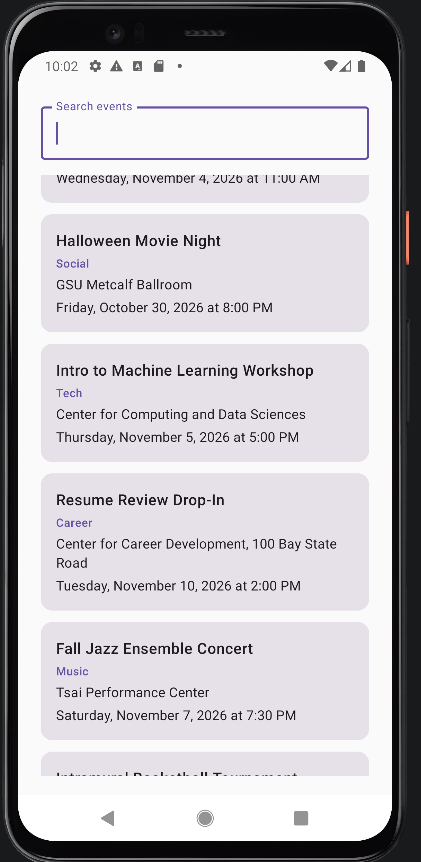
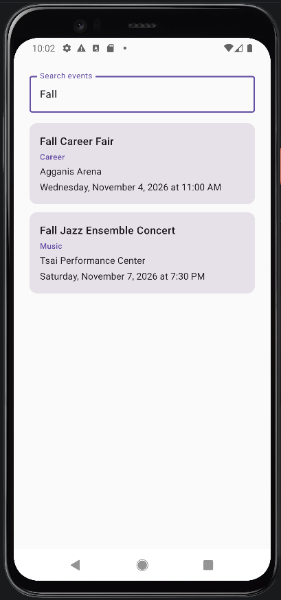
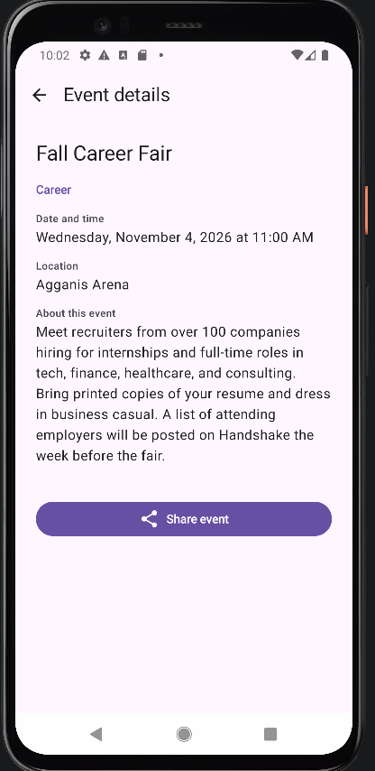
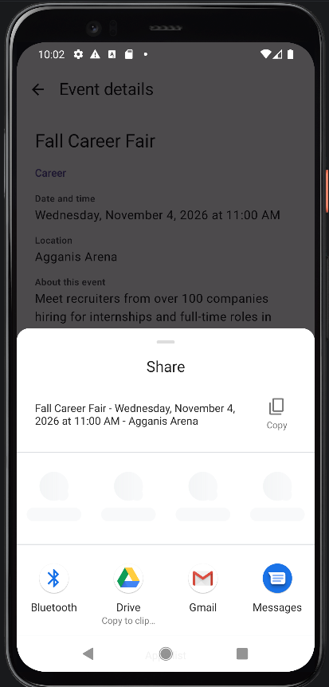
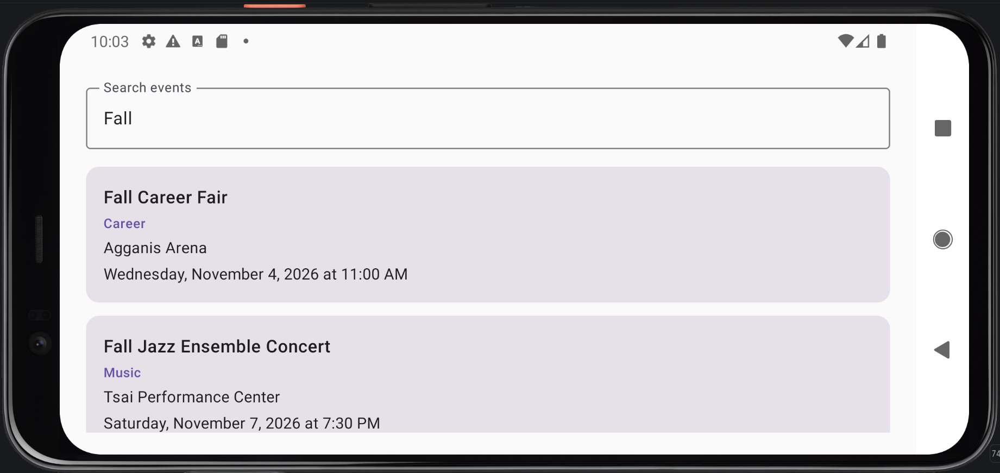
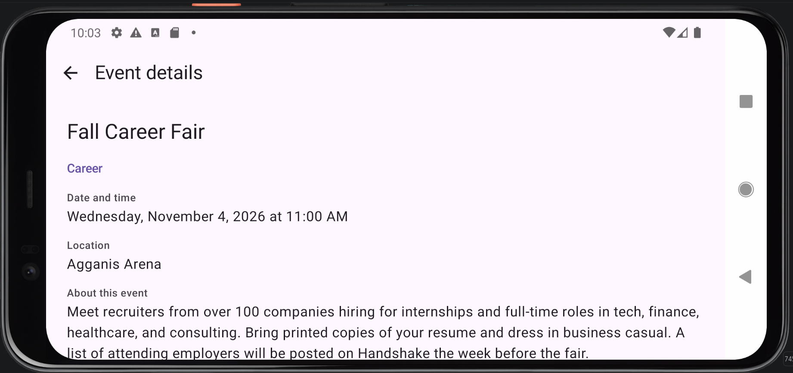

# Campus Event Explorer

An Android app built with Kotlin and Jetpack Compose for browsing campus events. The user can search events by title or category, open an event to see its full details, and share it with another app through the Android share sheet.

Tested on a Pixel 4 emulator (API 29).

## Screenshots

| Event list | Filtered list | Event details | Share sheet |
|---|---|---|---|
|  |  |  |  |

**Rotated (landscape)**

 

## Project structure

```
app/src/main/java/com/jerinjoseph/campus_event_explorer/
├── MainActivity.kt              Sets the theme and calls AppNavHost
├── data/CampusEvent.kt          CampusEvent data class and the 12 sample events
├── navigation/Routes.kt         Type-safe routes: EventList and EventDetail(eventId)
├── navigation/AppNavHost.kt     NavHost, search state, filtering and the share intent
└── ui/screens/
    ├── EventListScreen.kt       Search field and LazyColumn of events
    └── EventDetailScreen.kt     Event details, Up button, Share button, invalid ID state
```

## Questions

**1. Why does the route contain an event ID instead of the complete event object?**

The ID is small and stable, so it is easy for Navigation to save and restore. The detail destination looks the event up from the app's event list, which keeps one source of truth and lets the screen show "Event unavailable" when the ID does not match any event.

**2. Which composable owns the search state?**

The `composable<EventList>` destination inside `AppNavHost` owns `query`. `EventListScreen` only receives it as a parameter and reports changes through `onQueryChange`.

**3. Why does the search value use `rememberSaveable`?**

`remember` loses its value when the activity is recreated, for example on rotation. `rememberSaveable` stores the value in saved instance state, so the search text survives rotation and is still there when returning from the detail screen.

**4. What happens to the back stack when an event is selected?**

`navigate(EventDetail(id))` pushes an `EventDetail` entry on top of `EventList`. The list entry stays on the back stack with its saved state. Pressing Back or Up pops the detail entry and the list shows again.

**5. How does the UI request navigation without directly accessing the NavController?**

The screens expose lambdas such as `onEventSelected`, `onBack` and `onShare`. `AppNavHost` passes lambdas that call `navController.navigate()` or `popBackStack()`, so the screens never see the NavController.

**6. What makes the Share action an implicit intent?**

The intent only specifies an action (`ACTION_SEND`) and a data type (`text/plain`), not a target app. Android finds every app that can handle it, and `Intent.createChooser()` lets the user pick one.

## AI and collaboration disclosure

I did not collaborate with any other person on this assignment. I used Claude (Anthropic) as a guide while building the app. It helped me plan the project structure and Gradle setup, explained Navigation Compose and state concepts I was unsure about, and showed me example code for the screens and navigation when I was stuck. It also wrote the text for the 12 sample events and helped draft this README. I set up the project, adapted the code to my project, tested it on the emulator, fixed the errors I ran into with Claude's help, took the screenshots, made the commits and answered the README questions.

Prompts (summarized):

1. Explain the project structure and what each file is for
2. What to put in .gitignore to keep error logs and build files out of Git
3. Create 12 sample events for strings.xml
4. Best way to load string resources into the event list
5. Help fixing EventListScreen layout
6. The purpose of Routes.kt and why it matters, and why parts of AppNavHost are written the way they are
7. Why the NavHost import was unresolved
8. Why the Gradle dependencies are needed for navigation
9. Fixing UI issues in EventDetailScreen
10. Why the Material icon imports were unresolved
11. Resolving a crash while scrolling
12. Help drafting the README and this disclosure

The same disclosure is also in [AI_Disclosure.pdf](AI_Disclosure.pdf).
